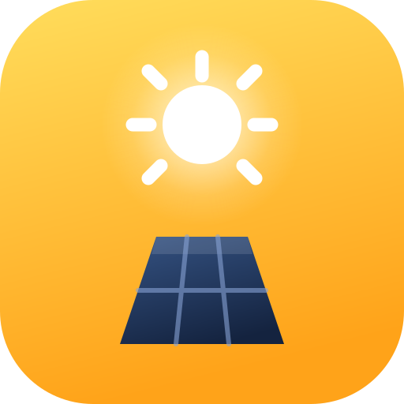

<p align="center">
  
</p>

<h1 align="center">โซลาร์มอนิเตอร์ · Deye Solar Monitor</h1>

<p align="center">
  <b>แอปดูระบบโซลาร์เซลล์ Deye แบบเรียลไทม์ ภาษาไทย</b><br>
  ผลิตไฟ · ใช้ไฟ · แบตเตอรี่ · ซื้อ-ขายไฟ ครบในแอปเดียว — ติดตั้งเป็นแอปบนมือถือ รันฟรีบน Cloudflare ทุน <b>0 บาท</b>
</p>

<p align="center">
  <a href="https://github.com/botnick/deyecloud/actions/workflows/ci.yml"></a>
  
  
  
  
  
</p>

<p align="center">
  <a href="https://deploy.workers.cloudflare.com/?url=https://github.com/botnick/deyecloud"></a>
</p>

<p align="center">
  <a href="https://botnick.github.io/deyecloud/"><b>เว็บไซต์</b></a> ·
  <a href="#ภาพหน้าจอ">ภาพหน้าจอ</a> ·
  <a href="#ฟีเจอร์">ฟีเจอร์</a> ·
  <a href="#ติดตั้ง-ฟรี">ติดตั้ง</a> ·
  <a href="#ตั้งค่า">ตั้งค่า</a> ·
  <a href="./ARCHITECTURE.md">สถาปัตยกรรม</a> ·
  <a href="./DEPLOY.md">คู่มือ deploy</a> ·
  <a href="#english">English</a>
</p>

<p align="center"></p>

---

## ทำไมต้องใช้

<table>
  <tr>
    <td width="33%" valign="top"><h3>⚡ เห็นสด อัปเดตทุกนาที</h3>บ้าน 3D ลากหมุนได้ จุดไฟวิ่งจากแผง แบต และเสาไฟเข้าบ้านตามทิศจริง จาก <b>Deye Cloud Open API</b> รีเฟรชเองทุก 1 นาที</td>
    <td width="33%" valign="top"><h3>📱 เหมือนแอปจริง ใช้ได้ทุกวัย</h3>ดีไซน์แบบ iPhone (หัวข้อใหญ่ แถบเมนูกระจก แป้น PIN) ตัวเลขใหญ่ ทุกสีมีคำกำกับ ปุ่มใหญ่ (Universal Design)</td>
    <td width="33%" valign="top"><h3>💸 ฟรีจริง</h3>Cloudflare Workers + D1 free tier ล้วน ไม่มีค่าเซิร์ฟเวอร์รายเดือน deploy ได้ใน 1 คลิก</td>
  </tr>
  <tr>
    <td valign="top"><h3>🧠 วิเคราะห์ให้เอง</h3>พยากรณ์ผลิตไฟที่เรียนรู้จากบ้านคุณ สุขภาพแบต ภาพรวมทั้งปี และคำแนะนำจากตัวเลขจริง (ไม่ใช่ AI เดา)</td>
    <td valign="top"><h3>🔔 แจ้งเตือนเมื่อมีปัญหา</h3>อินเวอร์เตอร์ออฟไลน์ ไฟดับ แบตต่ำ alarm จาก Deye ส่งเข้า Discord / Telegram ได้</td>
    <td valign="top"><h3>🔒 ปลอดภัย</h3>กุญแจ Deye อยู่ฝั่งเซิร์ฟเวอร์เท่านั้น ผู้ใช้เข้าด้วย PIN ไม่ต้องรู้รหัสบัญชี Deye</td>
  </tr>
</table>

---

## ภาพหน้าจอ

<table>
  <tr>
    <td align="center" width="25%"><br><b>หน้าหลัก</b><br><sub>สถานะ + ผังพลังงานสด</sub></td>
    <td align="center" width="25%"><br><b>วันนี้</b><br><sub>ผลิต / ใช้ / ซื้อ / ไฟย้อน</sub></td>
    <td align="center" width="25%"><br><b>อากาศ</b><br><sub>พยากรณ์ + ช่วงแดดดีสุด</sub></td>
    <td align="center" width="25%"><br><b>ย้อนหลัง</b><br><sub>วัน / เดือน / ปี / ตลอด</sub></td>
  </tr>
</table>

**บ้าน 3D บนหน้าหลัก** — ลากซ้าย-ขวาหมุนรอบบ้าน ขึ้น-ลงก้มเงยมุมกล้อง · จุดไฟวิ่งตามสายจริง (แผง → อินเวอร์เตอร์ → บ้าน / แบต / เสาไฟ) · ป้ายตัวเลขเกาะอุปกรณ์ · ท้องฟ้าและแสงตามเวลาจริงของบ้าน

<table>
  <tr>
    <td align="center"><br><sub>กลางวัน · ผลิตเต็ม + ขายไฟ</sub></td>
    <td align="center"><br><sub>แดดเย็น · ชาร์จแบต</sub></td>
    <td align="center"><br><sub>กลางคืน · ไฟในบ้านเปิด แบตจ่าย</sub></td>
  </tr>
  <tr>
    <td align="center" colspan="2"><br><sub>ใช้ไฟกลางวัน กับ กลางคืน (เที่ยงถึงเที่ยง)</sub></td>
    <td align="center"><br><sub>แบตเตอรี่ตอนนี้ · ใช้ได้ถึงกี่โมง</sub></td>
  </tr>
  <tr>
    <td align="center" colspan="2"><br><sub>ภาพรวมทั้งปี + คาดผลิตทั้งปี</sub></td>
    <td align="center"><br><sub>สุขภาพแบตเตอรี่ (วัดจริง)</sub></td>
  </tr>
</table>

---

## ฟีเจอร์

### ดูระบบแบบสด
- **หน้าหลัก** — บ้าน 3D หมุนได้พร้อมจุดไฟวิ่งตามทิศจริง, สถานะระบบ (ปกติ/แจ้งเตือน), ผลิตไฟวันนี้, เงินที่ประหยัดวันนี้ และ **เดือนนี้ประหยัดแล้ว** พร้อมตัวเลขคาดทั้งเดือน
- **แบตเตอรี่ตอนนี้** — กำลังชาร์จ/จ่ายเท่าไหร่ และ **เพราะอะไร** เป็นประโยคสั้นๆ, "ใช้ได้ถึงกี่โมง" / "เต็มราวกี่โมง" คิดจากความจุที่วัดจริงและจุดตัดที่เรียนรู้จากข้อมูลบ้านนี้ (ไม่ใช้ค่าบนฉลาก)
- **วันนี้** — สรุปผลิต/ใช้/ซื้อ/ไฟย้อน, สัดส่วนพึ่งพาตัวเอง, การหมุนเวียนพลังงาน · สลับมุมมอง **ทั้งวัน** หรือ **เที่ยงถึงเที่ยง** (เห็นการใช้ไฟกลางวันกับกลางคืนแยกกัน)
- **รายละเอียดเครื่อง** — ค่าต่อเฟส / PV string / BMS, **alarm จริงจากอินเวอร์เตอร์**, ตรวจสุขภาพระบบ (สมดุลเฟส · ช่องแบต · แรงดัน/ความถี่ · อุณหภูมิ — เงียบเมื่อปกติ), แนวโน้ม 1–90 วัน
- **หลายสถานี** — บัญชีมีหลายระบบ มีตัวสลับบนหัวจอให้เอง

<p>
  
  
</p>

### วิเคราะห์และพยากรณ์
- **พยากรณ์ที่เรียนรู้จากผลจริง** — ขนาดระบบสอบเทียบจากวันแดดดี + ค่าเมฆของบ้านนี้ปรับทุกวันจาก "คาด vs จริง" (วันใหม่มีน้ำหนักมากกว่า ตามฤดูทัน) · การ์ดความแม่นยำพยากรณ์: คะแนน + แท่งผลิตจริงรายวันพร้อมขีดที่คาดไว้ และป้าย แม่น / ต่ำไป / สูงไป
- **อากาศ** — พยากรณ์ TMD (หรือ Open-Meteo), เส้นทางดวงอาทิตย์ + ช่วงแดดดีสุด, ดัชนี UV, ราย ชม. + 7 วัน
- **สุขภาพแบตเตอรี่ (วัดจริง)** — ความจุใช้ได้จริงจากช่วงคายประจุ, SOH เทียบพิกัด BMS, จำนวนรอบ, ใช้ลึกเฉลี่ย, แนวโน้ม 60 วัน
- **ย้อนหลัง + ภาพรวมทั้งปี** — กราฟราย วัน/เดือน/ปี/ตลอด, สรุปรายเดือน (เงินที่ประหยัด, คาดทั้งเดือน, ยอดผลิต / ใช้ / ซื้อ / แบตจ่ายหรือขายคืน), เดือนดีสุด/แย่สุด, เทียบปีก่อน, คาดผลิตทั้งปีตามแดดของพิกัดบ้าน
- **คำแนะนำอัตโนมัติ** — คิดจากสมการสมดุลพลังงานของเลขจริง ปรับตามชนิดระบบ on-grid / hybrid / off-grid
- **เทียบ + ส่งออก** — เทียบช่วงก่อนหน้าแบบเวลาเท่ากัน (วันนี้ vs เมื่อวานถึงเวลานี้) · ดาวน์โหลด CSV ทุก 5 นาที / รายวัน / รายเดือน

<p>
  
  
  
</p>

### ทนทาน ไม่ต้องเฝ้า
- **แจ้งเตือนออกนอกแอป** (ไม่บังคับ) — Discord webhook / Telegram: อินเวอร์เตอร์ออฟไลน์, alarm เกิด/หาย, ไฟกริดหาย, แบตต่ำ, ฟ้าโปร่งแต่ไม่ผลิตไฟ — ส่ง "กลับมาปกติ" ให้ด้วย · ออกแบบให้ **ไม่เตือนมั่ว** (ต้องยืนยันหลายรอบก่อนส่ง)
- **ไม่บันทึกค่าปลอม** — ตัวส่งข้อมูลหลุด / Deye ส่งค่าค้าง ระบบรู้และไม่เก็บซ้ำ · กลับมาแล้ว **เติมข้อมูลย้อนหลังให้เอง**
- **แถบสถานะชัดเจน** — ต่อ Deye ไม่ได้ / ระบบหยุดเก็บ / อินเวอร์เตอร์ไม่ส่งข้อมูล บอกสาเหตุในแอป · `/api/_health` ใช้กับ uptime monitor ได้
- **ติดตั้งเป็นแอป (PWA)** — คำแนะนำติดตั้งปรับตามเครื่อง (Android / iPhone / Mac / อื่นๆ) · ใช้งาน offline ได้

---

## ติดตั้ง (ฟรี)

**ทางที่ 1 — คลิกเดียว:** กดปุ่ม **Deploy to Cloudflare** ด้านบน → Cloudflare สร้าง repo + ฐานข้อมูล D1 และถามค่าลับให้เอง → ได้ลิงก์ `https://deyecloud.<ชื่อคุณ>.workers.dev` เปิดบนมือถือแล้วกด **เพิ่มลงหน้าจอโฮม**

**ทางที่ 2 — คำสั่งเดียว (ใช้ส่วนตัว):**

```bash
npx wrangler login        # ล็อกอิน Cloudflare ครั้งเดียว
cp .dev.vars.example .dev.vars   # ใส่ DEYE_APP_SECRET, DEYE_PASSWORD, APP_PIN, TMD_TOKEN
npm run setup             # สร้าง D1 + ตั้งค่าลับ + build + deploy ให้อัตโนมัติ
```

อัปเดตครั้งต่อไป `npm run deploy` · ดู log `npm run tail` · ตารางใน D1 สร้างเองตอนใช้งานครั้งแรก และ cron เก็บข้อมูลเองทุก 5 นาที — รายละเอียดเต็มใน [`DEPLOY.md`](./DEPLOY.md)

<details>
<summary><b>รันบนเครื่องตัวเอง (สำหรับนักพัฒนา)</b></summary>

```bash
npm install
cp .dev.vars.example .dev.vars   # ใส่ค่าจริง
npm run dev                       # → http://localhost:5174  (มือถือใน LAN: http://<ip>:5174)
```

- ใส่ PIN ที่ตั้งไว้เพื่อเข้า · **cron ไม่ทำงานใน `vite dev`** → เปิด `GET /api/_poll` หนึ่งครั้งเพื่อดึงข้อมูลแรก (route `/api/_*` ต้องตั้ง `APP_PIN` และล็อกอินก่อน)
- ดูข้อมูลดิบจาก Deye `GET /api/_debug` · ทดสอบหน้าจอด้วยฉากจำลอง `?dev=1` หรือ `?sim=peak`

| คำสั่ง | ทำอะไร |
|---|---|
| `npm run dev` | dev server (port 5174) เสิร์ฟ Worker + หน้าเว็บ |
| `npm run build` | build → `dist/` |
| `npm run typecheck` · `npm test` | ตรวจ type · unit test (Vitest) |
| `npm run setup` | ตั้งค่า + deploy ครั้งแรกอัตโนมัติ |
| `npm run deploy` | build + deploy ขึ้น Cloudflare |
| `npm run db:create` / `db:init` | สร้าง / ตั้งตาราง D1 แบบ manual (ปกติ `setup` ทำให้แล้ว) |
| `npm run tail` | ดู log production |
| `node design/mockup.mjs` | ถ่ายภาพหน้าจอ + กรอบมือถือ → `docs/shots/` (ใช้กับเครื่องที่ deploy แล้วได้ด้วย `BASE=… PIN=…`) |

</details>

---

## ตั้งค่า

ตั้งน้อยที่สุด — **สถานี พิกัด กำลังติดตั้ง สถานที่ ดึงจาก Deye เองแล้วเก็บไว้** ไม่มีค่าส่วนตัวฝังในโค้ด · ค่าไฟ / ค่าขายคืน / ทุนติดตั้ง / CO₂ ตั้งในแอป (ย้อนหลัง → แท็บ "ตลอด" → ตั้งค่าการคำนวณ) ทุกเครื่องเห็นค่าเดียวกัน

| ต้องตั้ง | ที่มา |
|---|---|
| `DEYE_APP_ID`, `DEYE_EMAIL` | จาก [developer.deyecloud.com](https://developer.deyecloud.com) (ตั้งตอน deploy) |
| `DEYE_APP_SECRET`, `DEYE_PASSWORD` | **ค่าลับ** — `.dev.vars` (เครื่องตัวเอง) / `wrangler secret` (production) |
| `APP_PIN` | PIN เข้าแอป · ไม่ตั้ง = ดูได้สาธารณะ แต่หน้าผู้ดูแล `/api/_*` จะปิด |

<details>
<summary><b>ค่าเสริมทั้งหมด (ไม่ตั้งก็ใช้ได้)</b></summary>

| ตัวแปร | ใช้ทำอะไร |
|---|---|
| `DEYE_BASE_URL` | ค่าตั้งต้น EU (`eu1-developer…`) — เปลี่ยนเป็น us1 ถ้าบัญชีอยู่ US |
| `DEYE_STATION_ID` · `DEYE_COMPANY_ID` | ปักสถานีเจาะจง / company ของบัญชี |
| `TMD_TOKEN` · `TMD_BASE` | พยากรณ์อากาศกรมอุตุฯ (ไม่ตั้ง = ใช้ Open-Meteo) |
| `WEATHER_LAT` / `WEATHER_LON` / `WEATHER_PLACE` | ปรับพิกัดอากาศเอง |
| `ALERT_WEBHOOK_URL` · `TELEGRAM_BOT_TOKEN` + `TELEGRAM_CHAT_ID` | ช่องทางแจ้งเตือน |
| `ALERT_SOC_MIN` · `ALERT_REPEAT_MIN` · `ALERT_MUTE` · `ALERT_HEURISTICS` | เกณฑ์แบตต่ำ · เตือนซ้ำทุกกี่นาที (360) · ปิดรายกติกา · ส่งคำแนะนำเชิงวิเคราะห์ออกนอกแอปด้วย |
| `GRID_NOMINAL_V` / `GRID_NOMINAL_HZ` | แรงดัน/ความถี่ปกติของไซต์ (เช่น 230/50) — ไม่ตั้ง = ไม่เช็คค่าสัมบูรณ์ (จงใจไม่เดา) |
| `CONTACT_EMAIL` | อีเมลติดต่อที่แนบไปกับการค้นชื่อสถานที่ (OpenStreetMap ขอให้ระบุ) |
| `DEYE_RELAY_URL` | ทางอ้อมเมื่อ Deye บล็อกเครือข่าย Cloudflare — รัน `scripts/deye-relay.mjs` บนเครื่องอื่นแล้วใส่ที่อยู่ (ติดตั้งเองให้เปลี่ยนเป็นของคุณหรือลบออกจาก `wrangler.jsonc`) ดู [`DEPLOY.md`](./DEPLOY.md) |

</details>

---

## คำถามที่พบบ่อย

### โซลาร์มอนิเตอร์คืออะไร
แอปดูระบบโซลาร์เซลล์ที่ใช้อินเวอร์เตอร์ Deye แบบเรียลไทม์เป็นภาษาไทย ดึงข้อมูลจาก Deye Cloud Open API แล้วแสดงผลิตไฟ ใช้ไฟ แบตเตอรี่ และซื้อ-ขายไฟ พร้อมพยากรณ์และสรุปเงินที่ประหยัด ติดตั้งเป็นแอปบนมือถือได้

### ต้องเสียเงินไหม
ไม่ต้อง รันบน Cloudflare Workers + D1 ในโควต้าฟรี เก็บข้อมูลทุก 5 นาที (วันละ 288 ครั้ง) ต่ำกว่าลิมิตฟรี 100,000 ครั้งต่อวันมาก

### ใช้กับอินเวอร์เตอร์รุ่นไหนได้บ้าง
ระบบที่ส่งข้อมูลขึ้น Deye Cloud ทั้ง on-grid, hybrid และ off-grid แอปปรับคำแนะนำตามชนิดระบบให้เอง ต้องมีบัญชีนักพัฒนาที่ [developer.deyecloud.com](https://developer.deyecloud.com)

### ต่างจากแอป Deye Cloud อย่างไร
ภาษาไทยทั้งแอป ตัวเลขใหญ่อ่านง่าย มีพยากรณ์ที่เรียนรู้จากบ้านคุณ สุขภาพแบตจากการวัดจริง สรุปเงินที่ประหยัดรายเดือน แจ้งเตือน Discord / Telegram และคนในบ้านดูได้ด้วย PIN โดยไม่ต้องรู้รหัสบัญชี Deye

### ข้อมูลและรหัสผ่านปลอดภัยไหม
กุญแจและรหัสบัญชี Deye เก็บเป็นค่าลับฝั่งเซิร์ฟเวอร์ ไม่ส่งไปที่มือถือ เข้าแอปด้วย PIN หน้าแอปตั้งค่าไม่ให้ขึ้นในผลค้นหา และข้อมูลอยู่ในบัญชี Cloudflare ของคุณเอง

---

## สถาปัตยกรรมโดยย่อ

```
มือถือ (PWA) ─▶ Cloudflare Worker ─┬─▶ Deye Cloud Open API  (สด + ย้อนหลัง + อุปกรณ์ + alarm)
  เข้าด้วย PIN    หน้าเว็บ + /api/*   ├─▶ D1 (SQLite)          (ประวัติ + cache + token)
                  cron ทุก 5 นาที    └─▶ TMD / Open-Meteo     (อากาศ + UV ตามพิกัดสถานี)
```

ทุกอย่างอยู่ใน Worker เดียว · ค่าลับไม่ออกไปฝั่งมือถือ · ถ้า Deye บล็อกเครือข่าย Cloudflare จะอ้อมผ่าน relay ที่ตั้งไว้ (`DEYE_RELAY_URL`) · การรับแดด (ขึ้น-ตก, ช่วงแดดดี, ชั่วโมงแดดเต็ม) คำนวณจริงด้วย NOAA + Haurwitz · โควต้าต่อรอบของ free tier ถูกคิดไว้ในโค้ด (cron วันละ 288 ครั้ง ห่างลิมิต 100,000 req/วันมาก)

<p class="tech">
  <a href="https://vite.dev"></a>
  <a href="https://react.dev"></a>
  <a href="https://www.typescriptlang.org"></a>
  <a href="https://tailwindcss.com"></a>
  <a href="https://threejs.org"></a>
  <a href="https://hono.dev"></a>
  <a href="https://developers.cloudflare.com/workers/"></a>
  <a href="https://developers.cloudflare.com/d1/"></a>
  <a href="https://vite-pwa-org.netlify.app"></a>
  <a href="https://vitest.dev"></a>
  <a href="https://meteocons.com"></a>
</p>

---

## English

**Deye Solar Monitor** is a free, self-hosted real-time dashboard for **Deye solar inverters**, built on the official **Deye Cloud Open API**. It shows PV production, home load, battery state and grid import/export live, adds a production forecast that learns from your own roof, measured battery health, monthly savings, CSV export and Discord/Telegram alerts, and installs on a phone as a PWA. It runs entirely on the **Cloudflare Workers + D1 free tier** (no monthly cost). The app interface is Thai.

### Live view
- **Home** — a rotatable 3D house with power flowing in the real direction between panels, battery, grid and home; system status; today's production and savings, plus savings so far this month with a whole-month estimate
- **Battery now** — charging or discharging, the reason in one sentence, and when it will run out or be full, from measured capacity and the cut-off learned from this house
- **Today** — produced, used, bought and exported, self-sufficiency and energy flow, as a whole day or noon-to-noon (daytime and night-time use apart)
- **Device detail** — per-phase, PV string and BMS values, real inverter alarms, a quiet-when-normal health check, trends over 1–90 days
- **Several stations** — a switcher appears when the account has more than one system

### Analysis and forecast
- **A forecast that learns** — system size calibrated from clear days, cloud factors re-learned daily from forecast vs actual (recent days weigh more, so it follows the season); an accuracy card with a score and each day's production bar with a tick at the forecast, labelled on target / too low / too high
- **Weather** — Thai Meteorological Department forecast (or Open-Meteo), sun path and best sun window, UV index, hourly and 7-day
- **Measured battery health** — usable capacity from real discharges, SOH against the BMS rating, cycles, average depth, 60-day trend
- **History and year overview** — day / month / year / all-time charts, a month summary (savings, whole-month estimate, produced / used / bought / battery or exported), best and worst months, year-on-year, a whole-year estimate from the site's sunlight
- **Recommendations** — derived from the energy balance of measured values, adjusted for on-grid, hybrid or off-grid
- **Compare and export** — against the previous period at the same time of day; CSV every 5 minutes, daily or monthly

### Hands-off reliability
- **Alerts** (optional) — Discord webhook or Telegram: inverter offline, alarm raised or cleared, grid loss, low battery, clear sky but no production, plus "back to normal"; confirmed over several polls before sending
- **No fake values** — a dropped logger or stuck Deye values are detected and not stored; gaps are backfilled automatically when data returns
- **Clear status** — cannot reach Deye, collection stopped or inverter silent, each explained in the app; `/api/_health` for uptime monitors
- **Installable PWA** — install hints per device (Android, iPhone, Mac, others), works offline

### Install
- **Supports:** any Deye system on Deye Cloud — on-grid, hybrid, off-grid
- **Needs:** a Deye developer account ([developer.deyecloud.com](https://developer.deyecloud.com)) for an App ID and App Secret
- **One click:** the *Deploy to Cloudflare* button above; Cloudflare creates the repo and the D1 database and asks for the secrets
- **One command:** `npx wrangler login`, `cp .dev.vars.example .dev.vars`, then `npm run setup` — see [DEPLOY.md](./DEPLOY.md)

### FAQ

#### What is Deye Solar Monitor?
A free, self-hosted web app that shows a Deye solar system live — production, home load, battery and grid — using the official Deye Cloud Open API, with a forecast that learns from your own roof, measured battery health, savings and alerts. It installs on a phone as a PWA.

#### Does it cost anything?
No. It runs on the free tier of Cloudflare Workers and D1. It polls every 5 minutes (288 requests a day), far below the free limit of 100,000 a day.

#### Which inverters does it support?
Any system that reports to Deye Cloud — on-grid, hybrid or off-grid. You need a developer account at developer.deyecloud.com for an App ID and App Secret.

#### Is the interface in English?
The app interface is Thai, built for Thai households with large numbers and labelled colours. The code, API and setup work the same anywhere Deye Cloud is available.

#### Are my Deye credentials safe?
Deye keys and the account password are server-side secrets only and never reach the phone. People sign in with a PIN, the app is marked noindex, and all data stays in your own Cloudflare account.

---

<p align="center">
  สร้างด้วย ❤️ บน <b>Cloudflare Workers</b> ·
  <a href="./ARCHITECTURE.md">ARCHITECTURE.md</a> ·
  <a href="./DEPLOY.md">DEPLOY.md</a>
</p>
